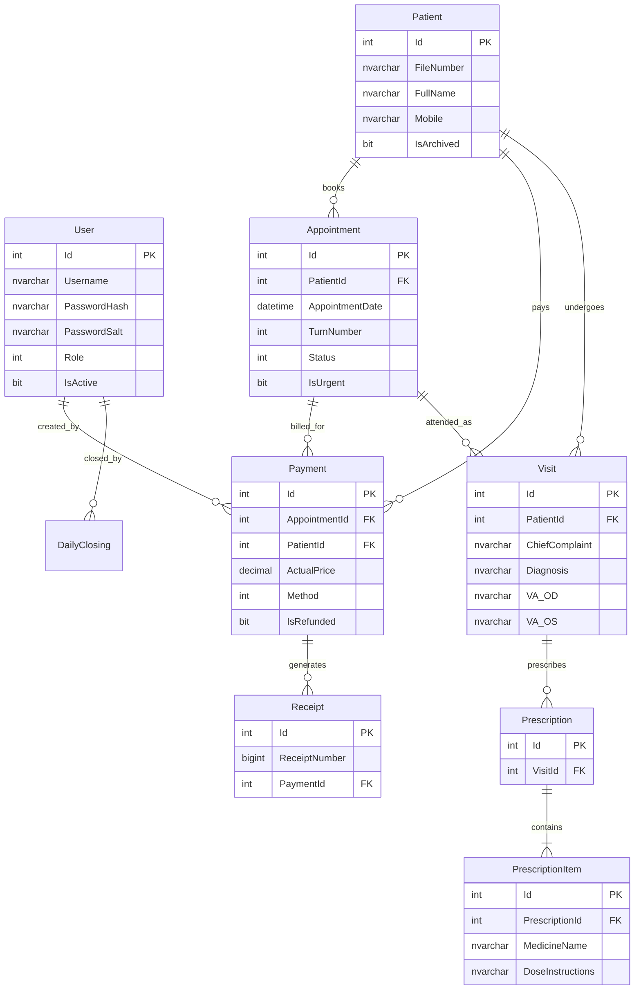
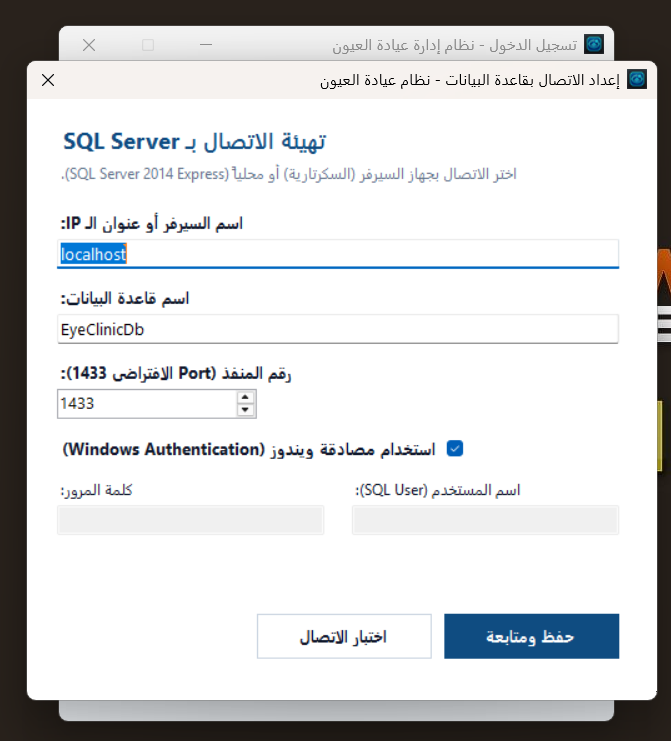
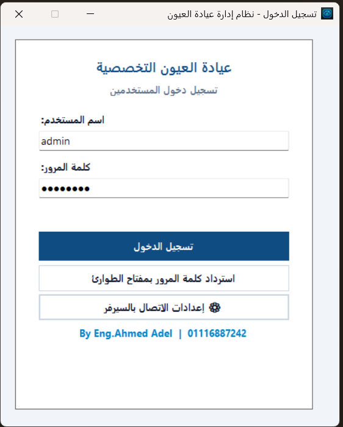
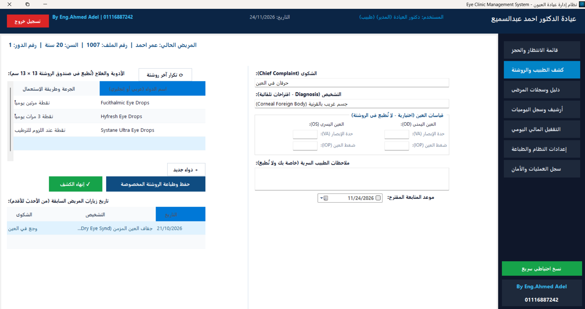
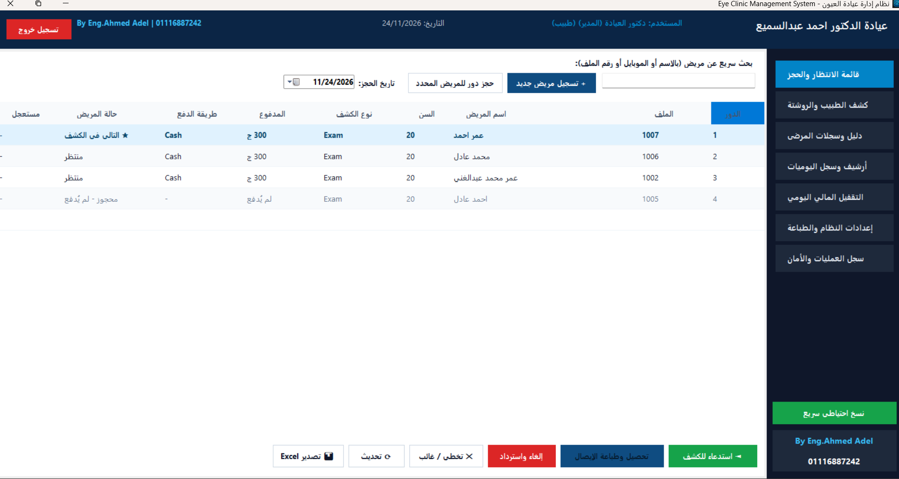

# 👁️ Eye Clinic Management System

[](https://dotnet.microsoft.com/)
[](https://docs.microsoft.com/en-us/dotnet/csharp/)
[](https://www.nuget.org/packages/EntityFramework/)
[-CC292B?style=flat&logo=microsoftsqlserver&logoColor=white)](https://www.microsoft.com/en-us/sql-server/)
[](https://www.microsoft.com/windows)
[-brightgreen?style=flat&logo=checkmarx&logoColor=white)](#tests)
[-orange?style=flat)](#architecture--repository-structure)
[](#installer--deployment)

A production-grade, enterprise-ready desktop healthcare management application designed for ophthalmology clinics. It bridges and orchestrates seamless, real-time collaboration between the **Reception/Secretary** (front-desk patient triage, FIFO queue tracking, and revenue collection) and the **Doctor/Administrator** (clinical examination, diagnostic coding, automated prescription generation, financial closing, and audit oversight).

Built with an **N-Tier Domain-Driven Architecture**, the system adheres strictly to enterprise software engineering standards, strong role-based access control (RBAC), multi-layer security protections, and low-latency Windows Forms UX optimized for Arabic (Right-to-Left) with full English input compatibility.

---

## 📑 Table of Contents

- [Key Features & Clinical Modules](#-key-features--clinical-modules)
- [Security & Authentication Architecture](#-security--authentication-architecture)
- [Zero-Config Database Setup (First-Launch Wizard)](#-zero-config-database-setup-first-launch-wizard)
- [Architecture & Repository Structure](#-architecture--repository-structure)
- [Database Schema (14 Normalized Tables)](#-database-schema-14-normalized-tables)
- [Demo Login Credentials](#-demo-login-credentials)
- [Getting Started & Installation](#-getting-started--installation)
- [Unit Testing & Verification](#-unit-testing--verification)
- [UI Screenshots](#-ui-screenshots)
- [Installer & Deployment](#-installer--deployment)

---

## 🌟 Key Features & Clinical Modules

### 1. 🗂️ Patient Registration & Smart Search
- **Single-Field Universal Query:** Fast search indexing patients across Full Name, Mobile Phone, and File Number simultaneously with real-time autocompletion.
- **Duplicate Detection Engine:** Automated heuristic checking warns if a patient with identical name or mobile exists while preventing duplicate file records.
- **Sequential File Numbering:** Gapless progression starting from file `#1001`.
- **Dynamic Age Calculation:** Exact birthday-to-date calculation with leap-year accounting.

### 2. ⏱️ Real-Time Queue & Triage Management
- **Deterministic FIFO Prioritization:**
  1. `InExam` (Active examination — Top priority)
  2. `Waiting (Urgent)` (Triaged urgent cases)
  3. `Waiting (Regular)` (Strict FIFO order by turn number)
  4. `BookedUnpaid` (Advance bookings up to 3 days ahead)
  5. `Completed`, `NoShow`, `Cancelled` (Bottom)
- **Role Isolation:** Secretary controls check-in, arrival, and payment status; Doctor advances queues via one-click patient calling.

### 3. 🔬 Ophthalmic Examination & Electronic Medical Records (EMR)
- **Confidential Clinical History:** Chronic diseases, drug allergies, and surgical histories restricted strictly to the Doctor role.
- **Bilateral Ophthalmic Measurements:** Standardized recording for Right Eye (OD) and Left Eye (OS) Visual Acuity (`VA`) and Intraocular Pressure (`IOP`).
- **Auto-Learning Dictionaries:** The catalog engine dynamically records frequently prescribed medications and ophthalmic diagnoses, autocompleting dosages and instructions over time.
- **One-Click Re-Prescription:** Instantly duplicates the patient's previous visit prescription to accelerate routine visits.

### 4. 🖨️ Precision Prescription & Thermal Receipt Printing
- **Custom Optical Paper Calibration:** Sub-millimeter offset configuration (`PrintService.cs`) calibrated for pre-printed clinical stationery (16.7 cm × 24.0 cm).
- **Thermal POS Receipts:** 80mm ESC/POS layout formatting with gapless receipt numbering (`#10001+`), timestamping, breakdown of payment method, and cashier attribution.

### 5. 💰 Financial Billing & Daily Closing Reconciliation
- **Multi-Method Payment:** Cash, Vodafone Cash, and InstaPay support.
- **Re-Examination Eligibility Engine:** Enforces clinic rules (e.g., 14-day window for discounted re-examination linked to the original payment ID).
- **End-of-Day Cash Balancing:** Automated calculation comparing counted physical cash against system-expected drawer cash, isolating electronic transfers and recording discrepancy notes.
- **Audited Re-opening:** Strict doctor-only override protocol with mandatory reason recording.

---

## 🔒 Security & Authentication Architecture

Security and privacy are engineered directly into every tier:

```
[User Login Input]
        │
        ▼
[AuthService.Login()] ──► Checks Lockout State (FailedAttempts >= 5 -> 15 min lock)
        │
        ▼
[PasswordHasher.VerifyPassword()]
        │
        ├─► Extract 24-byte Salt from Base64
        ├─► Compute PBKDF2 (HMAC-SHA1, 10,000 iterations, 32-byte key)
        └─► Constant-Time Comparison (SlowEquals prevents timing attacks)
        │
        ▼
[SessionContext.SetSession()] ──► Role-Based Permissions (Doctor vs. Secretary)
```

- **PBKDF2 Password Hashing:** Powered by `System.Security.Cryptography.Rfc2898DeriveBytes` utilizing cryptographically strong random salts (`RNGCryptoServiceProvider`, 24 bytes), 32-byte derived hashes, and **10,000 PBKDF2 iterations**.
- **Timing Attack Mitigation:** Password verification uses a constant-time `SlowEquals` XOR loop to prevent side-channel timing analysis.
- **Brute-Force Lockout:** Automatically locks any account for **15 minutes after 5 consecutive failed attempts**.
- **Session Auto-Timeout:** Built-in idle inactivity monitor triggers automatic logout (10 minutes for Doctor, 30 minutes for Reception).
- **Offline Master Recovery Key:** High-entropy 24-character cryptographic recovery key (`XXXX-XXXX-XXXX-...`) allowing the Doctor to perform emergency offline password resets without external dependencies.
- **Immutable Audit Logging:** Every financial price override, refund, account modification, and daily closing change is logged to an immutable `AuditLog` table capturing actor, timestamp, action type, and JSON state diffs (`OldValuesJson` / `NewValuesJson`).

---

## ⚡ Zero-Config Database Setup (First-Launch Wizard)

Unlike typical enterprise desktop applications that require recruiters or developers to modify configuration files, this application includes a **Zero-Config Self-Healing Connection Pipeline**:

```
[Application Startup]
        │
        ▼
[ConnectionConfig.GetConnectionString()]
        │
        ├─► Looks for %ProgramData%\EyeClinic\connection.json
        │
        ├──[File Found & Connected] ──► Initialize EF6 Context & Launch App
        │
        └──[File Missing or Connection Failed]
                    │
                    ▼
          [ConnectionSetupForm GUI] (Interactive Wizard)
                    │
                    ├─ Test Connection Button (Instant validation)
                    ├─ Windows Authentication or SQL Server Auth
                    ├─ Encrypts credentials via Windows DPAPI
                    └─ Saves config and resumes startup seamlessly
```

- **Secure Storage:** SQL Server credentials stored in `%ProgramData%\EyeClinic\connection.json` are encrypted using **Windows DPAPI** (`ProtectedDataScope.LocalMachine`).
- **No Manual Edits Required:** No XML editing or connection string tampering needed in `App.config`.

---

## 🏛️ Architecture & Repository Structure

The solution follows a strict **N-Tier Domain-Driven Separation of Concerns**:

```
EyeClinic.sln
├── src/
│   ├── EyeClinic.Core/            # Domain Entities, Enums, DTOs, Session & Result patterns
│   │   ├── Common/                # Result<T>, SessionContext
│   │   ├── DTOs/                  # QueueItemDto, PatientProfileDto, DailyRevenueDto, etc.
│   │   ├── Entities/              # 14 EF6 Entity Models (User, Patient, Visit, Payment, etc.)
│   │   └── Enums/                 # UserRole, AppointmentStatus, ExamType, PaymentMethod
│   │
│   ├── EyeClinic.Data/            # Persistence & Security Layer
│   │   ├── Configuration/         # ConnectionConfig.cs (DPAPI, JSON Loader, Connection Builder)
│   │   ├── Context/               # EyeClinicDbContext (Fluent API mapping, Audit Interceptor)
│   │   │                          # DbInitializer.cs (Schema auto-verification & seed loader)
│   │   └── Security/              # PasswordHasher.cs (PBKDF2 implementation)
│   │
│   ├── EyeClinic.Business/        # Business Logic & Orchestration Services
│   │   └── Services/              # AuthService, PatientService, QueueService, VisitService,
│   │                              # PaymentService, DailyClosingService, BackupService,
│   │                              # PrintService, CatalogService, ExcelExportService
│   │
│   └── EyeClinic.WinForms/        # Presentation Layer (Windows Forms UI, RTL, Theming)
│       ├── Forms/                 # MainForm, LoginForm, ConnectionSetupForm, PatientEditDialog,
│       │                          # PatientProfileDialog, PaymentDialog, RefundDialog, etc.
│       └── Theme/                 # UITheme.cs (Color palette, typography, RTL hierarchy engine)
│
├── tests/
│   └── EyeClinic.Tests/           # Automated Unit Test Suite (27 test cases, 100% pass)
│       ├── Framework/             # Lightweight assertion framework
│       └── UnitTests/             # Patient, Payment, DailyClosing, Backup, & Crypto tests
│
├── Database/                      # Ready-to-execute T-SQL Scripts
│   ├── database.sql               # Complete SQL Server 2014 DDL schema (14 tables, FKs, indexes)
│   └── seed_data.sql              # Realistic Egyptian clinical demo data & pre-hashed accounts
│
├── installer/                     # Inno Setup 6 packaging & deployment scripts
│   ├── EyeClinic_Setup.iss        # Production installer script targeting Windows 7 SP1 to 11
│   └── Database_Setup_SQL2014.sql # Offline database installation script
│
└── Screenshots/                   # Application UI preview captures
    └── .gitkeep
```

---

## 🗄️ Database Schema (14 Normalized Tables)

Designed for **SQL Server 2014 Express** (Compatibility Level 120, Collation `Arabic_CI_AS`):



| Table Name | Entity Class | Purpose | Key Constraints |
|---|---|---|---|
| `[dbo].[User]` | `User.cs` | System operators | Unique `Username`, PBKDF2 hash & salt |
| `[dbo].[Patient]` | `Patient.cs` | Patient demographic & clinical records | Indexed `FileNumber`, `Mobile`, `FullName` |
| `[dbo].[Appointment]` | `Appointment.cs` | Daily queue and appointments | FK to `Patient`, indexed `[Date, Status]` |
| `[dbo].[Payment]` | `Payment.cs` | Financial payment transactions | Precision `(18,2)`, FKs to `Appointment` & `User` |
| `[dbo].[Receipt]` | `Receipt.cs` | Sequential audit receipts | Unique `ReceiptNumber` (`BIGINT`) |
| `[dbo].[Visit]` | `Visit.cs` | Examination records & diagnostic metrics | FK to `Patient`, bilateral eye measurements |
| `[dbo].[Prescription]` | `Prescription.cs` | Visit prescription header | FK to `Visit` |
| `[dbo].[PrescriptionItem]`| `PrescriptionItem.cs` | Prescribed drugs & dosages | Cascade-delete on `PrescriptionId` |
| `[dbo].[PrescriptionTemplate]` | `PrescriptionTemplate.cs`| Reusable prescription templates | Serialized items JSON |
| `[dbo].[MedicineCatalog]` | `MedicineCatalog.cs` | Auto-learning ophthalmic medications | Usage counter, auto-updating default dose |
| `[dbo].[DiagnosisCatalog]` | `DiagnosisCatalog.cs`| Auto-learning ophthalmic diagnoses | Usage counter, frequency ranking |
| `[dbo].[DailyClosing]` | `DailyClosing.cs` | End-of-day register balancing | Unique `ClosingDate`, expected vs actual cash |
| `[dbo].[AuditLog]` | `AuditLog.cs` | Immutable system security log | `BIGINT` PK, JSON state changes diff |
| `[dbo].[ClinicSetting]` | `ClinicSetting.cs` | Dynamic clinic parameters & calibration | String PK `SettingKey` |

---

## 🔑 Demo Login Credentials

The `Database/seed_data.sql` script pre-populates the database with pre-configured, instantly active demo credentials:

| Role | Username | Password | Access Level & Permissions |
|---|---|---|---|
| **Doctor / Admin** | `doctor` | `Doctor@123` | **Full Administrative Access**<br>• EMR, Diagnoses, Clinical Examination<br>• Prescription Writing & Calibration<br>• Financial Reports & Revenue Analytics<br>• User Management & System Settings |
| **Secretary / Receptionist** | `secretary` | `Secretary@123` | **Front-Desk & Reception**<br>• Patient Registration & Demographics<br>• Appointment Booking & FIFO Queue Triage<br>• Payment Processing & Receipt Printing<br>• Daily Cash Drawer Closing |

> [!NOTE]
> Demo accounts are initialized with `MustChangePassword = 0`, allowing instant evaluator login without forced password update prompts.

---

## 🚀 Getting Started & Installation

### Prerequisites
- **Visual Studio 2019 / 2022** (with *.NET desktop development* workload)
- **.NET Framework 4.8 Developer Pack**
- **Microsoft SQL Server 2014 Express** (or any newer SQL Server 2016-2022 edition)
- **SQL Server Management Studio (SSMS)**

### Step 1: Initialize Database
1. Open SSMS and connect to your local SQL Server instance (e.g., `localhost` or `.\SQLEXPRESS`).
2. Open and execute [`Database/database.sql`](file:///Database/database.sql) to create `EyeClinicDb` and the 14 relational tables.
3. Open and execute [`Database/seed_data.sql`](file:///Database/seed_data.sql) to seed configuration keys, demo patients, today's queue items, and the pre-hashed demo accounts.

### Step 2: Build & Run the Solution
1. Clone or open the project folder in Visual Studio:
   ```bash
   git clone https://github.com/your-username/eye-clinic-management-system.git
   ```
2. Open `EyeClinic.sln`.
3. Right-click the Solution and select **Restore NuGet Packages** (fetches `EntityFramework 6.4.4` and `Newtonsoft.Json 13.0.3`).
4. Set `EyeClinic.WinForms` as the Startup Project.
5. Press **F5** (or `Ctrl+F5`) to build and launch.

### Step 3: First-Launch Connection Setup
If the application cannot locate a previous `%ProgramData%\EyeClinic\connection.json` file, the **Connection Setup Wizard** automatically appears:
- **Server:** Enter your SQL Server name (e.g., `.` or `localhost` or `.\SQLEXPRESS`).
- **Database:** `EyeClinicDb`.
- **Authentication:** Check *Windows Authentication* (or provide SQL credentials).
- Click **اختبار الاتصال (Test Connection)** to verify, then **حفظ ومتابعة (Save & Continue)**.
- Log in using the [Demo Credentials](#-demo-login-credentials).

---

## 🧪 Unit Testing & Verification

The repository features an automated test runner (`tests/EyeClinic.Tests/Program.cs`) covering core domain logic:

```bash
# Execute the test suite binary
tests\EyeClinic.Tests\bin\Debug\EyeClinic.Tests.exe
```

### Test Suite Results (100% Pass Rate):
```
=================================================
 Eye Clinic Management System - Unit Test Runner 
 Target: .NET Framework 4.8 | C# 7.3             
=================================================

Running: PatientLogicTests
  [PASS] Test_AgeCalculation_AccurateFromBirthDate
  [PASS] Test_AgeCalculation_NullWhenBirthDateMissing
  [PASS] Test_SequentialFileNumber_Progression
  [PASS] Test_PatientValidation_RequiresNameAndMobile

Running: PaymentAndReExamTests
  [PASS] Test_ReExamEligibility_Within14Days_IsEligible
  [PASS] Test_ReExamEligibility_Beyond14Days_RequiresNewExam
  [PASS] Test_RefundValidation_RequiresMandatoryReason
  [PASS] Test_PricingCalculation_ExamTypes

Running: DailyClosingCalculationTests
  [PASS] Test_DailyClosing_ZeroDiscrepancy
  [PASS] Test_DailyClosing_DeficitCalculation
  [PASS] Test_DailyClosing_SurplusCalculation
  [PASS] Test_ElectronicPayment_SegregatedFromDrawerCash

Running: BackupServiceTests
  [PASS] Test_BackupFilename_FollowsRequiredPattern
  [PASS] Test_FormatSize_DisplaysCorrectUnits
  [PASS] Test_BackupRotation_RetainsOnlyLatestCopies
  [PASS] Test_WeeklyFlashReminder_Calculation

Running: ExcelExportServiceTests
  [PASS] Test_ExportListToCsv_GeneratesUtf8BomHeader

Running: PatientImportServiceTests
  [PASS] Test_ImportPreview_ValidatesRequiredFieldsAndHeaders
  [PASS] Test_ImportPreview_DetectsDuplicatePhoneNumbersInFile
  [PASS] Test_ExportErrorsToCsv_GeneratesUtf8BomFile

Running: UserAccountValidationTests
  [PASS] Test_UpdateUserAccount_RequiresDoctorRole
  [PASS] Test_UpdateUserAccount_ValidatesUsernameAndFullName
  [PASS] Test_RoleArabicTranslation_FormattedCorrectly

Running: MasterRecoveryKeyTests
  [PASS] Test_GenerateRecoveryKey_LengthAndUnambiguousCharset
  [PASS] Test_NormalizeRecoveryKey_HandlesDashesSpacesAndCase
  [PASS] Test_MasterRecoveryKey_CryptographicHashing
  [PASS] Test_RecoverDoctorPassword_ValidationRules

-------------------------------------------------
Total Tests: 27 | Passed: 27 | Failed: 0
ALL UNIT TESTS PASSED SUCCESSFULLY! (100% OK)
```

---

## 📸 UI Screenshots

Place application screenshots into the `Screenshots/` directory:

| First-Launch Database Setup | Operator Login Screen |
|:---:|:---:|
|  |  |

| Reception & Queue Dashboard | Ophthalmic EMR & Prescription |
|:---:|:---:|
|  |  |

---

## 📦 Installer & Deployment

The system includes a production **Inno Setup 6** installer script located in [`installer/EyeClinic_Setup.iss`](file:///installer/EyeClinic_Setup.iss):
- **Target OS Compatibility:** Windows 7 Service Pack 1 up to Windows 11 (x64 / x86).
- **Environment Prerequisites Check:** Automatically validates `.NET Framework 4.8` presence (Release DWORD `>= 528040`) prior to installation.
- **Role-Based Installation Types:**
  - **Server / Reception Station:** Deploys client binaries alongside SQL Server initialization scripts.
  - **Doctor Workstation:** Deploys the thin client configured to connect to the local clinic network.
- **Enterprise Packaging:** Creates desktop shortcuts, registers uninstaller, embeds icons, and includes bilingual Arabic/English installation wizards.

---

## 👨‍💻 Author

**Eng. Ahmed Adel**  
DevOps & Cloud Engineer
